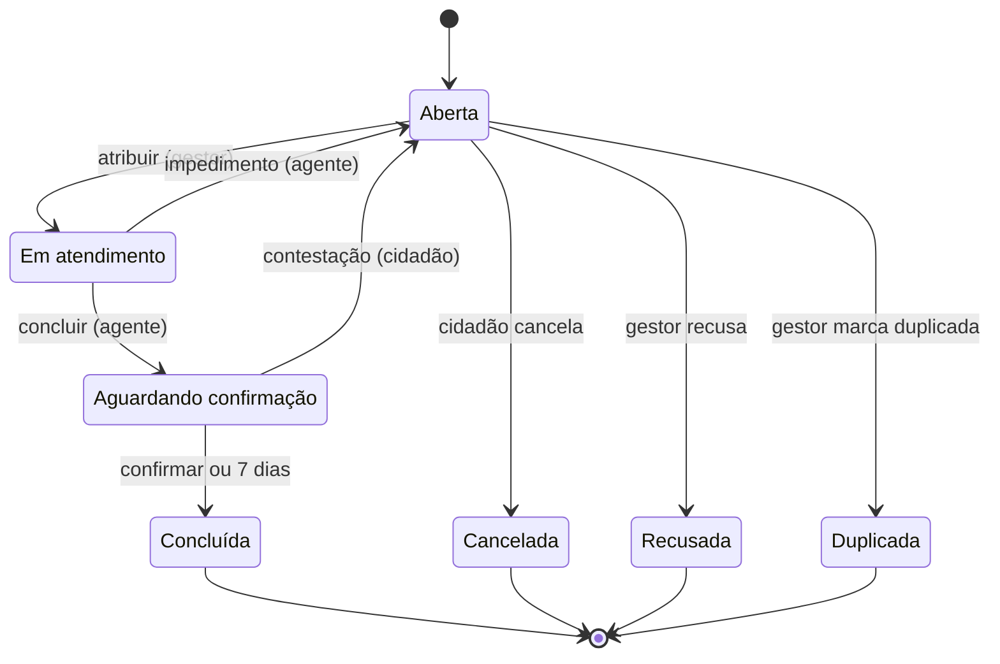

# Alô Cidadão — Planejamento do MVP

21/10/2026

## Contexto e decisões

O Alô Cidadão será um produto SaaS próprio, ainda sem cliente: o MVP precisa ser demonstrável e vendável a prefeituras com custo de infraestrutura de \~US$ 20–35/mês. Base: Declaração de Escopo v0 (01/04/2026).

| Tema             | Decisão                                                                                              | Motivo                                                               |
| ---------------- | ---------------------------------------------------------------------------------------------------- | -------------------------------------------------------------------- |
| Distribuição     | Um único app "Alô Cidadão" (Android e iOS), telas por perfil                                         | Uma ficha por loja, um par de credenciais de push                    |
| Linguagem        | TypeScript em todas as camadas, monorepo (pnpm + Turborepo)                                          | Tipos e validações compartilhados entre API, WEB e app               |
| App              | React Native + Expo (development build)                                                              | Acesso nativo completo (câmera, localização, rede) com produtividade |
| WEB              | React (Vite), mapas com MapLibre/Leaflet + OpenStreetMap                                             | Sem custo de mapas                                                   |
| API              | Node.js + Fastify, REST, schemas Zod, JWT                                                            | Mesma linguagem do restante                                          |
| Banco            | PostgreSQL + PostGIS + JSONB, Row-Level Security por prefeitura                                      | Dados relacionais, consultas geográficas, isolamento multi-tenant    |
| Notificações     | Serviço próprio enviando direto a FCM (Android) e APNs (iOS) + caixa de notificações no app + e-mail | Sem fornecedor intermediário; envio gratuito                         |
| Infraestrutura   | DigitalOcean: 1 Droplet com Docker Compose + Spaces (fotos e backups)                                | Barato e portável para outro provedor                                |
| Contas nas lojas | Conta de organização (CNPJ + D-U-N-S)                                                                | Exigência da Apple e credibilidade                                   |

## Corte do MVP

O MVP fecha um ciclo completo de irregularidade — cidadão reporta, prefeitura atribui, equipe executa, cidadão confirma — e deixa serviços, workflows configuráveis e relatórios avançados para depois.

| Módulo                     | Entra no MVP                                                                                                                                                                                                   | Fica para depois                                                                                                       |
| -------------------------- | -------------------------------------------------------------------------------------------------------------------------------------------------------------------------------------------------------------- | ---------------------------------------------------------------------------------------------------------------------- |
| Cidadão (app)              | Cadastro e login; escolha da prefeitura; registro de irregularidade com foto, localização, categoria e descrição; lista das próprias solicitações com status e histórico; confirmar ou contestar o atendimento | Solicitação de serviços (IPTU, vigilância sanitária); prioridade definida pelo cidadão; login Gov.br; denúncia anônima |
| Gestor da prefeitura (WEB) | Lista com filtros (status, categoria, data, bairro); mapa com pins; triagem (aceitar, recusar, marcar duplicada); atribuir a equipe com prazo                                                                  | Atribuição automática; SLAs por categoria; relatórios e indicadores                                                    |
| Agente de campo (app)      | Lista de atividades da equipe; navegação até o local; iniciar, concluir com foto e relato, ou registrar impedimento; uso offline com sincronização                                                             | Reprogramar pelo próprio agente; checklists por categoria                                                              |
| Admin da prefeitura (WEB)  | Usuários, equipes, setores e categorias da prefeitura                                                                                                                                                          | Relatórios                                                                                                             |
| Admin da plataforma (WEB)  | Cadastro e ativação de prefeituras; criação do admin de cada prefeitura; catálogo padrão de categorias                                                                                                         | Editor visual de workflows; cobrança e planos                                                                          |

**Critério de pronto do MVP:** uma demonstração ponta a ponta com duas prefeituras de teste isoladas, em aparelhos Android e iOS reais, incluindo um atendimento registrado offline e notificações push em cada mudança de status.

O editor visual de workflows é o item mais caro do escopo original; no MVP o fluxo de status é fixo e cada prefeitura configura apenas suas categorias.

## Perfis e permissões

Cinco perfis, todos com login único por e-mail ou celular; os quatro perfis da prefeitura só enxergam dados da própria prefeitura, garantido pelo banco (Row-Level Security), não só pela API.

| Perfil (no código)                     | Plataforma | Vê                                    | Pode fazer                                                                                   |
| -------------------------------------- | ---------- | ------------------------------------- | -------------------------------------------------------------------------------------------- |
| Cidadão (`citizen`)                    | App        | As próprias solicitações              | Criar solicitação, acompanhar, confirmar ou contestar atendimento, cancelar antes da triagem |
| Agente de campo (`field_agent`)        | App        | Atividades das equipes a que pertence | Iniciar, concluir com foto e relato, registrar impedimento                                   |
| Gestor (`manager`)                     | WEB        | Solicitações dos setores que gerencia | Triar, atribuir a equipe, definir prazo, reatribuir, encerrar                                |
| Admin da prefeitura (`tenant_admin`)   | WEB        | Tudo da prefeitura                    | Usuários, equipes, setores, categorias; tudo que o gestor faz                                |
| Admin da plataforma (`platform_admin`) | WEB        | Todas as prefeituras                  | Criar e ativar prefeituras, criar o admin de cada uma, catálogo padrão de categorias         |

Uma mesma pessoa pode ter mais de um perfil (um servidor que também é cidadão); o app mostra a troca de perfil quando houver mais de um.

## Modelo de domínio

O centro do modelo é a **Solicitação** (o que o cidadão pediu) separada da **Atividade** (o trabalho de campo): uma solicitação pode gerar mais de uma atividade, por exemplo após um impedimento ou uma contestação. Toda tabela da prefeitura carrega `tenant_id`.

| Entidade                         | Atributos principais                                                                              | Relacionamentos                                                 |
| -------------------------------- | ------------------------------------------------------------------------------------------------- | --------------------------------------------------------------- |
| Prefeitura (`tenant`)            | nome, município, UF, código IBGE, limite geográfico (polígono), ativa                             | tem setores, equipes, categorias, usuários                      |
| Usuário (`user`)                 | nome, e-mail, celular, CPF (opcional no MVP), senha                                               | tem vínculos de perfil                                          |
| Vínculo de perfil (`membership`) | perfil, prefeitura (nulo para admin da plataforma)                                                | usuário × prefeitura × perfil                                   |
| Setor (`department`)             | nome (ex.: Obras, Limpeza Urbana)                                                                 | pertence à prefeitura; tem gestores, equipes, categorias        |
| Equipe (`team`)                  | nome                                                                                              | pertence a um setor; tem agentes                                |
| Categoria (`category`)           | nome, ícone, setor responsável, prazo padrão (dias), campos extras (JSONB), ativa                 | copiada do catálogo padrão e ajustável por prefeitura           |
| Solicitação (`request`)          | protocolo, status, descrição, localização (ponto PostGIS), endereço, campos extras (JSONB), prazo | do cidadão, de uma categoria; tem atividades, anexos, histórico |
| Atividade (`work_order`)         | status, equipe, prazo, relato de conclusão, motivo de impedimento                                 | de uma solicitação; atribuída a uma equipe                      |
| Anexo (`attachment`)             | tipo (abertura, conclusão, contestação), chave no Spaces, localização e hora da captura           | de uma solicitação ou atividade                                 |
| Histórico (`status_event`)       | status anterior, novo status, autor, comentário, data, contexto da conexão                        | de uma solicitação ou atividade; só inserção                    |
| Notificação (`notification`)     | destinatário, evento, título, lida em                                                             | caixa de entrada no app                                         |
| Aparelho (`device`)              | plataforma, token de push, versão do app, último acesso                                           | de um usuário                                                   |

**Contexto da conexão** (tipo de rede, geração móvel, latência até a API, tempo de envio das fotos, se foi enviado offline) é gravado em cada evento de histórico e anexo.

O protocolo é sequencial por prefeitura e ano (ex.: `2026-000123`), para o cidadão citar ao telefone.

## Ciclo de status

A solicitação tem sete status e um único caminho até Concluída; tudo que exige decisão do gestor (impedimento, contestação) volta para **Aberta**, que funciona como a fila de triagem.

| De                     | Para                   | Quem               | Condição                                    |
| ---------------------- | ---------------------- | ------------------ | ------------------------------------------- |
| Aberta                 | Cancelada              | Cidadão            | Antes de ser atribuída                      |
| Aberta                 | Recusada               | Gestor             | Motivo obrigatório                          |
| Aberta                 | Duplicada              | Gestor             | Ligada à solicitação original               |
| Aberta                 | Em atendimento         | Gestor             | Cria a atividade para uma equipe, com prazo |
| Em atendimento         | Aguardando confirmação | Agente             | Conclusão com foto e relato                 |
| Em atendimento         | Aberta                 | Agente             | Impedimento com motivo                      |
| Aguardando confirmação | Concluída              | Cidadão ou sistema | Confirmação, ou 7 dias sem resposta         |
| Aguardando confirmação | Aberta                 | Cidadão            | Contestação com comentário e foto           |

A atividade de campo tem ciclo próprio: **Atribuída → Em execução → Concluída**, ou **Impedida** (pelo agente) e **Cancelada** (pelo gestor, ao reatribuir ou encerrar). Uma solicitação tem no máximo uma atividade ativa por vez. Estados e transições ficam no pacote `shared` e são validados na API.

## Fluxos principais

Quatro fluxos cobrem o ciclo do MVP; o quinto prepara uma prefeitura nova para usar o sistema.

**1. Cidadão registra uma irregularidade (app)**

1. Abre o app já logado; na primeira vez escolhe a prefeitura (sugerida pela localização).
2. Toca em "Nova solicitação", escolhe a categoria e tira a foto (até 3).
3. Confirma o local no mapa (GPS preenchido, ajustável) e escreve a descrição.
4. A API valida que o ponto está dentro do limite da prefeitura, gera o protocolo e grava status **Aberta**.
5. Sem conexão, a solicitação fica na fila do aparelho e é enviada quando a rede voltar; o protocolo só aparece depois do envio.

**2. Gestor tria e atribui (WEB)**

1. Vê as solicitações abertas dos seus setores em lista e no mapa.
2. Decide: recusar (com motivo), marcar como duplicada (ligando à original) ou atribuir.
3. Ao atribuir, escolhe a equipe e o prazo (pré-preenchido pela categoria); a API cria a Atividade e a solicitação passa para **Em atendimento**.

**3. Agente executa (app)**

1. Vê as atividades das suas equipes, ordenadas por prazo e distância; o app baixa os dados para uso offline.
2. Abre a rota no app de mapas do aparelho e toca em "Iniciar".
3. Conclui com foto e relato, ou registra impedimento com motivo (ex.: precisa de máquina, local inacessível).
4. Conclusão leva a solicitação para **Aguardando confirmação**; impedimento a devolve ao gestor como **Aberta**.

**4. Cidadão confirma ou contesta (app)**

1. Recebe o push "Sua solicitação foi atendida" com a foto da conclusão.
2. Confirma (vira **Concluída**) ou contesta com comentário e foto (volta para **Aberta**, marcada como reaberta).
3. Sem resposta em 7 dias, a solicitação é concluída automaticamente.

**5. Prefeitura nova entra no sistema (WEB)**

1. O admin da plataforma cadastra a prefeitura, importa o limite do município e cria o admin da prefeitura.
2. O admin da prefeitura cria setores, equipes e usuários e ajusta as categorias copiadas do catálogo padrão.
3. A prefeitura passa a aparecer na escolha de município do app quando ativada.

## Notificações

Toda mudança de status gera uma notificação na caixa de entrada do app; o push é o aviso dela, e o e-mail entra só onde o destinatário precisa agir.

| Evento                                         | Destinatário      | Push      | E-mail |
| ---------------------------------------------- | ----------------- | --------- | ------ |
| Solicitação recebida (protocolo gerado)        | Cidadão           | Sim       | Não    |
| Solicitação recusada ou duplicada              | Cidadão           | Sim       | Não    |
| Solicitação em atendimento                     | Cidadão           | Sim       | Não    |
| Atendimento concluído, aguardando confirmação  | Cidadão           | Sim       | Sim    |
| Nova atividade atribuída                       | Agentes da equipe | Sim       | Não    |
| Impedimento registrado                         | Gestores do setor | Não (WEB) | Sim    |
| Contestação do cidadão                         | Gestores do setor | Não (WEB) | Sim    |
| Convite de acesso (novo usuário da prefeitura) | Usuário convidado | Não       | Sim    |

O conteúdo do push leva só protocolo e status, sem nome, endereço ou descrição. Envios passam por uma fila no backend com nova tentativa e descarte de tokens inválidos.

## Requisitos não funcionais

Os requisitos que mais pesam no MVP são o uso offline do agente de campo e o isolamento entre prefeituras; os demais seguem práticas padrão.

| Tema                 | Requisito no MVP                                                                                                                                                           |
| -------------------- | -------------------------------------------------------------------------------------------------------------------------------------------------------------------------- |
| Offline (agente)     | Atividades da equipe baixadas no aparelho (SQLite); iniciar, concluir e registrar impedimento sem rede; envio em fila com nova tentativa; fotos comprimidas antes do envio |
| Offline (cidadão)    | Nova solicitação pode ser criada sem rede e fica na fila; consultas exigem conexão                                                                                         |
| Conflitos            | O servidor é a fonte da verdade: ação offline sobre atividade reatribuída ou cancelada é recusada e o agente é avisado                                                     |
| Qualidade da conexão | Tipo de rede, geração móvel, latência até a API e tempo de envio das fotos gravados em cada ação                                                                           |
| Isolamento           | `tenant_id` em toda tabela da prefeitura + Row-Level Security no Postgres; testes automáticos tentando ler dados de outra prefeitura                                       |
| Autenticação         | JWT de curta duração + refresh token; senha com hash forte; bloqueio após tentativas falhas                                                                                |
| Fotos                | Envio direto ao Spaces por URL assinada; leitura só por URL assinada com validade curta; metadados EXIF de localização removidos das fotos exibidas ao público             |
| LGPD                 | Termo de uso e política de privacidade no cadastro; coleta mínima (CPF opcional); exclusão de conta pelo app; registro de quem acessou dados pessoais                      |
| Histórico            | Eventos de status apenas inseridos, nunca alterados (trilha de auditoria)                                                                                                  |
| Backups              | `pg_dump` diário para o Spaces, mantido por 30 dias, com restauração testada                                                                                               |
| Observabilidade      | Logs estruturados, rastreamento de erros no app e na API, verificação de saúde da API                                                                                      |

## Testes de risco e próximos passos

Com este planejamento aprovado, o próximo passo é montar o monorepo e, junto com ele, provar os quatro pontos que podem mudar a arquitetura.

| Teste                     | Como provar                                                                                        | Pronto quando                                                             |
| ------------------------- | -------------------------------------------------------------------------------------------------- | ------------------------------------------------------------------------- |
| Push direto FCM e APNs    | API envia para um aparelho Android e um iPhone reais usando o token nativo do `expo-notifications` | Push chega nos dois, com app aberto, em segundo plano e fechado           |
| Offline com fotos         | Agente conclui 3 atividades com foto em modo avião e reconecta                                     | Tudo sincroniza sem duplicar; conflito de atividade reatribuída é avisado |
| Isolamento por prefeitura | Duas prefeituras de teste com RLS; testes tentando ler e escrever dados da outra                   | Todas as tentativas falham no banco, mesmo com a API ignorando o filtro   |
| Recursos nativos no Expo  | Development build com câmera, localização e `netinfo` + medição de latência                        | Funciona em Android e iOS reais, permissões pedidas no momento do uso     |

- [x] Revisar e aprovar este planejamento
- [x] Criar o monorepo (pnpm, Turborepo, TypeScript, lint, CI)
- [x] Pacote `shared` com perfis, status e transições em Zod
- [ ] Executar os quatro testes de risco
  - [x] Isolamento por prefeitura — `packages/db`, ver `docs/decisoes/0001-isolamento-por-prefeitura.md`
  - [ ] Recursos nativos no Expo — provado no emulador Android; falta aparelho real, Android e iPhone (ver `docs/decisoes/0002-recursos-nativos-offline-e-push.md`)
  - [ ] Offline com fotos — provado no emulador Android (modo avião, conflito, fechamento forçado); falta aparelho real (ver decisão 0002)
  - [ ] Push direto FCM e APNs — não provado: registro e envio prontos e testados, sem entrega real; faltam os arquivos do Firebase e a conta Apple (ver decisão 0002)
- [ ] Abrir as contas de organização na Apple (D-U-N-S) e no Google Play
- [ ] Quebrar o MVP em atividades estimadas

### Próximos planos

Um de cada vez, depois dos testes de risco.

1. **Modelo de dados do design:** as migrações da seção 9 do spec (ocorrências, atividade nova, usuários sem senha, prefeitura com status, contrato, papéis internos, auditoria) e as transições novas no `shared`.
2. **Acesso:** código por celular no app, CPF + código por e-mail (Resend, `nao-responda@alocidadao.com.br`) no painel, sessões, `devices` e a regra dos 90 dias.
3. **App do cidadão:** telas 0 a 8, prefeitura pela localização, agrupamento pela 5b e registro offline, reaproveitando a fila dos testes de risco.
4. **App do agente:** telas A1 a A5, sobre a fila e o cache dos testes de risco.
5. **Painel da prefeitura:** W0 a W7, com mapa, triagem, agrupamento, atribuição, revisão e configurações.
6. **Backoffice:** P1 a P6.
7. **Notificações:** fila de envio, caixa de entrada, e-mails e conclusão automática em 7 dias.
8. **Infraestrutura:** Droplet e Spaces na DigitalOcean, backups, observabilidade e publicação nas lojas.

## Perguntas em aberto

- [ ] Cadastro do cidadão: e-mail ou celular (SMS tem custo por mensagem)? CPF opcional ou obrigatório?
- [ ] Solicitações ficam visíveis para outros cidadãos (mapa público, "eu também") ou só para quem abriu?
- [ ] Prazo da conclusão automática sem resposta do cidadão: 7 dias serve?
- [ ] Quantas contestações por solicitação antes de exigir decisão do gestor?
- [ ] Catálogo padrão de categorias: quais entram (buraco, iluminação, lixo, poda, esgoto, calçada...)?
- [ ] Nome e marca: "Alô Cidadão" está livre para registro e nas lojas?
- [ ] Modelo de cobrança das prefeituras (por habitante, por usuário, valor fixo) — afeta o que medir desde o MVP
